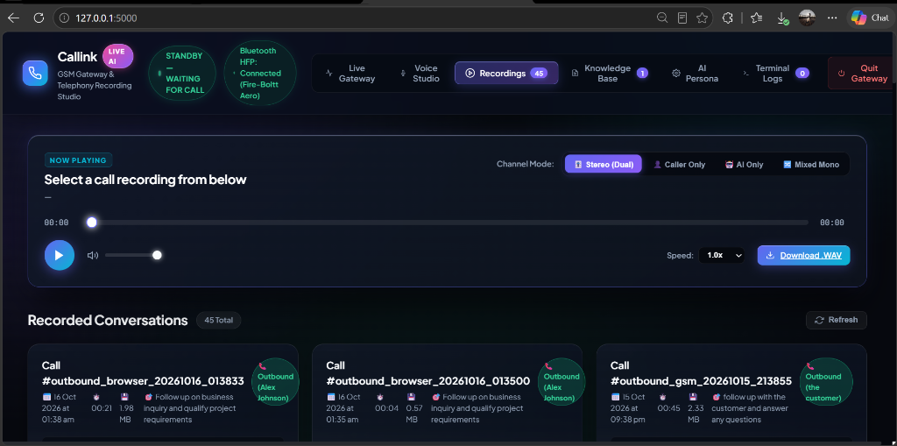
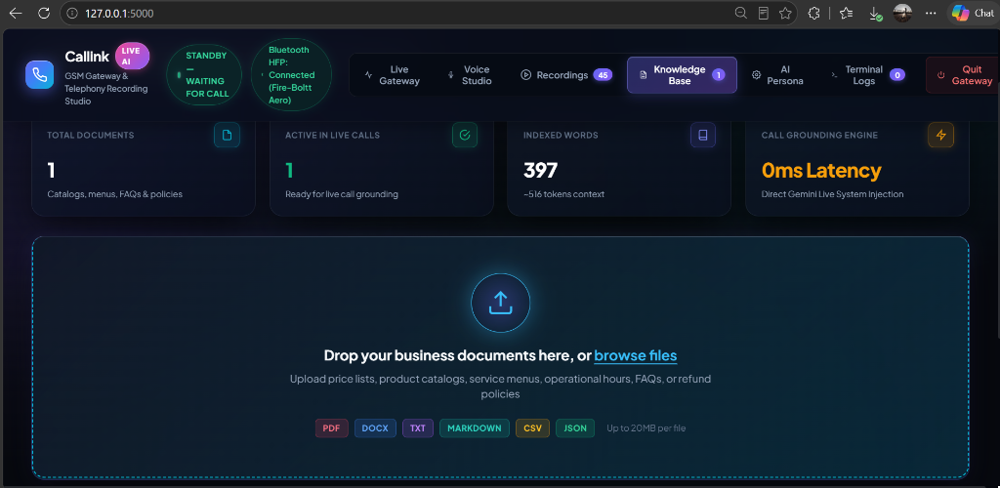
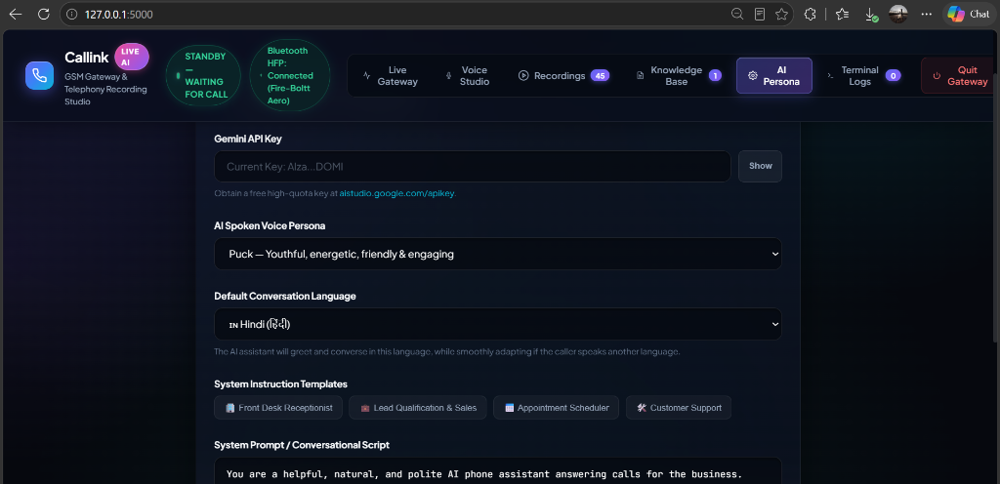

# Callink: GSM-to-Gemini Live AI Voice Gateway & Studio

<div align="center">


-brightgreen?style=for-the-badge)


**A high-performance Windows telephony gateway bridging standard cellular telephone calls directly to Google's multimodal Gemini Live API (`gemini-3.1-flash-live-preview`) over Bluetooth Hands-Free Profile (HFP).**

[Features](#-key-features) • [Live Call Demo](#-real-world-live-call-recording-demo) • [Architecture](#-architecture--telephony-pipeline) • [Latency Benchmark](#-latency-benchmark-callink-vs-legacy-telephony) • [Quickstart](#-quickstart-1-click-on-windows) • [Dashboard Overview](#-glassmorphic-web-dashboard) • [Troubleshooting](#-troubleshooting--audio-tuning)

<br><br>


</div>

---

## 🎙️ Real-World Live Call Recording Demo

Experience an actual, unedited ~8-minute cellular phone conversation handled autonomously by Callink and Google's multimodal Gemini Live voice model (`gemini-3.1-flash-live-preview`).

> **Call Highlights:**
> - **Call Direction:** Autonomous Outbound Cellular Call (placed via Android SIM)
> - **Duration:** 8 minutes 14 seconds
> - **Language:** Hindi & Natural Hinglish dialogue
> - **Latency & Audio:** Direct Bluetooth SCO bridge (~800ms turn-around latency)

https://github.com/user-attachments/assets/7e4e574b-712d-4961-aad7-a972e3ad5125

<br>

<div align="center">

[](https://github.com/user-attachments/assets/7e4e574b-712d-4961-aad7-a972e3ad5125)
[-blue?style=for-the-badge)](https://github.com/Anupthakurr/callink/raw/main/assets/call_demo_outbound.mp3)

</div>


---

## 🌟 What is Callink?

**Callink was created to build an ultra-responsive AI voice calling agent with virtually $0 cost for personal and everyday business use cases.**

Unlike conventional voice AI platforms that force you to buy expensive virtual telephony numbers, SIP trunks, or pay steep per-minute fees to third-party services like **Bolna, Twilio, VoiceLink, or Exotel**, **Callink does NOT require any virtual AI phone number**. Instead, it runs directly on **your own existing smartphone and personal cellular phone number**!

Anyone can call your standard mobile number to converse with your AI agent, and you can dispatch proactive outbound calls straight through your cellular SIM card—without paying a single cent in telephony infrastructure or VoIP subscription charges.

Unlike traditional telephony solutions that require expensive cloud SIP trunks, Asterisk PBX servers, and cascaded STT &rarr; LLM &rarr; TTS pipelines that suffer from 3–5 seconds of awkward conversational delay, **Callink bridges your physical smartphone's Bluetooth baseband audio directly to Google's native speech-to-speech Gemini Live WebSocket gateway on Windows**.

The result is a conversational turn-around latency of **~800ms to 1.2s**, complete with natural barge-in interruptions, multilingual code-switching, automated dual-track recording, and enterprise knowledge grounding.

---

## 🏛️ Architecture & Telephony Pipeline

```text
  +---------------------------------------------------------------------------------------+
  |                               CELLULAR TELEPHONY LAYER                                |
  |                                                                                       |
  |   +-----------------------+              (GSM / VoLTE Carrier Network)                |
  |   | Standard Mobile Phone | <======================================================>  |
  |   | Caller / Recipient    |                                                         | |
  |   +-----------------------+                                                         | |
  |                                                                                     | |
  |                                                                                     v |
  |                                                    +--------------------------------+ |
  |                                                    |     Android Smartphone         | |
  |                                                    |   with "Link to Windows"       | |
  |                                                    +----------------+---------------+ |
  +---------------------------------------------------------------------|-----------------+
                                                                        |
                                         Bluetooth HFP / SCO Audio Link | (16 kHz 16-Bit PCM Bidirectional)
                                         & Phone Link Protocol (tel:)   |
                                                                        v
  +---------------------------------------------------------------------------------------+
  |                          WINDOWS PC GATEWAY HOST (Callink Engine)                     |
  |                                                                                       |
  |   +------------------------------------+    +-------------------------------------+   |
  |   | 1. WinRT Telephony Detector        |    | 2. Proactive Outbound Dialer        |   |
  |   |    PhoneCallManager zero-polling   |    |    Phone Link (tel:) & ADB dialer   |   |
  |   |    automatic call pickup & hangup  |    |    Auto-greeting priming engine     |   |
  |   +-----------------+------------------+    +------------------+------------------+   |
  |                     |                                          |                      |
  |                     +--------------------+---------------------+                      |
  |                                          |                                            |
  |   +--------------------------------------v----------------------------------------+   |
  |   | 3. Bluetooth SCO Audio Bridge (WASAPI / sounddevice)                          |   |
  |   |    • 20ms hardware audio sampling @ 16 kHz 16-bit mono PCM                   |   |
  |   |    • 120ms dynamic SCO jitter buffer & 100ms WebSocket frame batcher          |   |
  |   +--------------------------------------+----------------------------------------+   |
  |                                          |                                            |
  |   +--------------------------------------v----------------------------------------+   |
  |   | 4. Hardware-Calibrated VAD & Live Dynamic Barge-In Engine                     |   |
  |   |    • Client-side RMS threshold (Default 950 RMS, real-time live adjustable)   |   |
  |   |    • Instant playback queue flush & interrupted turn transcript logger        |   |
  |   +--------------------------------------+----------------------------------------+   |
  |                                          |                                            |
  |   +--------------------------------------v----------------------------------------+   |
  |   | 5. Synchronized Dual-Track Call Recorder & Resampler (audioop / scipy)        |   |
  |   |    • Left: Clean Caller Voice (16kHz) | Right: Gemini AI Voice (16kHz)        |   |
  |   |    • High-fidelity 16 kHz <---> 24 kHz in-memory resampler                    |   |
  |   +--------------------------------------+----------------------------------------+   |
  |                                          |                                            |
  |                     +--------------------+--------------------+                       |
  |                     |                                         |                       |
  |                     v                                         v                       |
  |   +------------------------------------+    +-------------------------------------+   |
  |   | 6. Knowledge Grounding Engine      |    | 7. aiohttp Web Platform & Telemetry |   |
  |   |    In-memory document parser       |    |    Live WebSocket VU meters (L/R)   |   |
  |   |    Zero-latency prompt grounding   |    |    Dual-track player & REST APIs    |   |
  |   +-----------------+------------------+    +------------------+------------------+   |
  |                     |                                          |                      |
  |                     |                                          | HTTP / WebSockets    |
  |                     |                                          v                      |
  |                     |                       +-------------------------------------+   |
  |                     |                       | Obsidian Glassmorphic Web Dashboard |   |
  |                     |                       | (http://localhost:5000)             |   |
  |                     |                       +-------------------------------------+   |
  +---------------------|-----------------------------------------------------------------+
                        |
                        | Bidirectional Secure WebSocket (gemini-3.1-flash-live-preview)
                        v
  +---------------------------------------------------------------------------------------+
  |                              GOOGLE GEMINI LIVE CLOUD                                 |
  |                                                                                       |
  |   • Native Multimodal Speech-to-Speech Engine (Audio In <---> Audio Out)              |
  |   • Real-Time Multilingual Code-Switching (Hindi, English, Hinglish, Maithili, etc.)  |
  |   • Zero-STT / Zero-TTS Architecture (~800ms ultra-low turnaround latency)            |
  +---------------------------------------------------------------------------------------+
```

---

## ⚡ Latency Benchmark: Callink vs. Legacy Telephony

Callink was engineered from first principles to overcome the prohibitive conversational latency inherent in traditional telephony architectures (Asterisk PBX + Twilio/Telnyx SIP trunks + Dograh/LiveKit proxy + cascaded STT &rarr; LLM &rarr; TTS pipelines).

### Performance Breakdown

| Pipeline Stage | Legacy Architecture <br>*(Asterisk + SIP Trunk + STT/LLM/TTS)* | Callink Architecture <br>*(Direct Bluetooth HFP + Gemini Live)* | Latency Eliminated |
| :--- | :--- | :--- | :--- |
| **Call Capture & Ingestion** | **~250 – 400 ms** <br>GSM carrier &rarr; SIP Trunk &rarr; Asterisk PBX &rarr; RTP jitter buffer & transcoding | **~30 – 50 ms** <br>Physical GSM modem &rarr; Bluetooth HFP (SCO link) hardware capture (16 kHz 16-bit PCM) | **~250 – 350 ms** |
| **Telephony Gateway / Proxy** | **~150 – 250 ms** <br>SIP proxy / Dograh webhook overhead, framing & packet forwarding | **0 ms** <br>Completely eliminated (Zero PBX / Zero SIP server) | **~150 – 250 ms** |
| **Speech-to-Text (STT)** | **~400 – 700 ms** <br>Buffer chunk accumulation & text transcription (Whisper / Deepgram) | **0 ms** <br>Eliminated (Direct native audio-in multimodal tokens) | **~400 – 700 ms** |
| **LLM Reasoning & TTFT** | **~800 – 1,500 ms** <br>Text prompt serialization & HTTP stream wait time | **~400 – 600 ms** <br>Native continuous token streaming | **~400 – 900 ms** |
| **Text-to-Speech (TTS)** | **~450 – 800 ms** <br>External TTS buffer synthesis wait (ElevenLabs / Cartesia) | **0 ms** <br>Eliminated (Model directly streams 24 kHz raw PCM audio chunks) | **~450 – 800 ms** |
| **Turn Detection / VAD** | **~600 – 900 ms** <br>Client-side silence threshold wait before dispatching audio to STT | **~350 – 500 ms** <br>Server-side continuous streaming semantic turn detection | **~250 – 400 ms** |
| **Return Audio Streaming** | **~200 – 300 ms** <br>TTS audio &rarr; middleware &rarr; Asterisk RTP &rarr; SIP Trunk carrier | **~30 – 50 ms** <br>Gemini WebSocket chunk &rarr; Windows Bluetooth SCO output queue | **~170 – 250 ms** |
| **TOTAL ROUND-TRIP LATENCY** | **~3,200 – 4,500+ ms (3.2 – 4.5s)** | **~800 – 1,200 ms (0.8 – 1.2s)** | **~2,400 – 3,300 ms saved (~70% to 75% drop)** |

---

## ✨ Key Features

### 1. 💰 $0 Telephony Cost & Runs on Your Own Phone Number
- **Zero Third-Party Telephony Numbers:** No need to buy, configure, or pay monthly subscriptions for virtual phone numbers from **Bolna, Twilio, VoiceLink, Exotel**, or cloud SIP trunk providers.
- **Uses Your Real Cellular SIM:** Runs directly through the SIM card already inside your smartphone using standard carrier voice calling.
- **Trusted Personal Identity:** When you dispatch outbound calls or receive inbound calls, it operates on your real cellular number—never an unknown VoIP or spam-flagged virtual number.

### 2. 📞 Inbound & Outbound Cellular AI Telephony
- **Automatic Inbound Detection:** Automatically answers incoming phone calls via Windows Runtime (`PhoneCallManager`) and starts the AI conversation without manual intervention.
- **Outbound AI Call Dispatcher:** Dispatch proactive outbound calls directly from the web dashboard. Enter the recipient's phone number, name, and conversation goal—the AI dials via Windows Phone Link / Android dialer and speaks first with a tailored greeting!
- **Call Pre-Warming:** Telephony listeners detect incoming rings and pre-initialize WebSocket connections to achieve zero-latency pickup.

### 2. 🌐 Multilingual Auto-Detection & Code-Switching
- **Dynamic Language Detection:** The AI automatically detects the caller's spoken language in real-time (Hindi, English, Spanish, French, German, Japanese, Hinglish, etc.) and naturally matches their language and dialect.
- **Custom Default Language:** Set your business's default conversational language in the dashboard settings with seamless fallback adaptation.

### 3. 🎨 Obsidian Glassmorphic Web Dashboard
- **Futuristic Studio UI:** A sleek dark-mode glassmorphic dashboard (`http://localhost:5000`) built with multi-layer ambient lighting, frosted glass cards, and glowing telemetry nodes.
- **Dual-Channel Live VU Meters:** Real-time LED audio level meters with decibel and RMS readouts for both the caller's microphone and Gemini AI's voice.
- **Live Hardware Nodes:** Instant visual status for Windows Phone Link, Bluetooth HFP SCO bridge, Gemini Live API connection, and Windows Stay-Awake guard.
- **Real-Time Auto-Scrolling Transcripts:** Watch speech bubbles appear live on screen as caller and AI converse.

### 4. 🎙️ Dual-Track Call Recording & Master Web Player
- **Studio-Grade Stereo WAVs:** Every call is automatically recorded to disk (`recordings/`) in synchronized 16 kHz 16-bit stereo WAV format:
  - **Left Channel (L):** Isolated caller microphone.
  - **Right Channel (R):** Isolated Gemini AI voice.
- **Master Audio Player with Channel Isolation:** Built-in Web Audio API player allows you to toggle **Stereo (Dual)**, isolate **Caller Only**, isolate **AI Only**, or blend to **Mixed Mono** with playback speed control (0.75x – 2.0x).
- **JSON Metadata & Transcripts:** Full timestamped JSON transcripts saved alongside every WAV recording.

### 5. 🧠 Instant In-Browser Voice Studio
- Talk directly to the Gemini Live AI voice agent in your browser using your PC's microphone and speakers.
- Perfect for testing prompts, rehearsing outbound scripts, or testing document knowledge without dialing a phone number.

### 6. 📚 Zero-Latency Business Knowledge Base Grounding
- Upload business documents (`.pdf`, `.docx`, `.txt`, `.md`, `.csv`, `.json`) directly through the web UI.
- Text is automatically extracted, tokenized, and injected straight into Gemini Live's system context.
- Provides grounded, accurate answers on pricing, business policies, menus, and support questions with **zero vector database lookup latency**.

### 7. 🛡️ Enterprise Hardware Resilience
- **Anti-Cut Barge-In Engine:** Calibrated client-side RMS speech detection and immediate audio playback buffer purging allows callers to interrupt the AI naturally.
- **Windows Stay-Awake Guard:** Integrated with Win32 `kernel32.SetThreadExecutionState` (`ES_SYSTEM_REQUIRED | ES_AWAYMODE_REQUIRED`) to prevent PC/laptop sleep and keep Bluetooth and network links alive 24/7.
- **120ms Dynamic SCO Jitter Buffer:** Absorbs Bluetooth packet jitter on Windows for smooth, glitch-free telephony playback.

---

## 💻 Hardware & System Requirements

| Component | Minimum Specification | Recommended Specification |
| :--- | :--- | :--- |
| **Operating System** | Windows 10 (64-bit, build 19041+) | Windows 11 (64-bit, latest build) |
| **Smartphone** | Android smartphone with active cellular SIM | Android 10+ with active SIM & Bluetooth 5.0+ |
| **PC Bluetooth** | Bluetooth 4.2 adapter | Bluetooth 5.0+ USB dongle or internal card |
| **Companion Software** | Microsoft **Phone Link** on PC <br>Microsoft **Link to Windows** on Android | Pre-installed on Windows 10/11 <br>Available free on Google Play Store |
| **API Credentials** | Google Gemini API Key | High-quota key from [Google AI Studio](https://aistudio.google.com/) |

> [!IMPORTANT]
> Both devices must be paired through **Phone Link** with the **Calls** feature enabled. This activates the required `Hands-Free HF Audio` Bluetooth SCO endpoints in Windows Sound Settings and allows Windows `PhoneCallManager` to detect cellular telephone events.

---

## 🚀 Quickstart (1-Click on Windows)

### Option 1: Standalone Single Executable (`Callink.exe`) — Zero Python Required!
If you want to run Callink or share it with others who don't have Python installed:
1. Double-click **`Callink.exe`** in the repository root (or download from Releases).
2. On first launch, if your API key isn't configured, enter your `GEMINI_API_KEY` when prompted.
3. The dashboard opens automatically at **`http://localhost:5000`**!

### Option 2: 1-Click Batch Runner (`run.bat`)
1. Clone this repository:
   ```bash
   git clone https://github.com/Anupthakurr/callink.git
   cd callink
   ```
2. Double-click **`run.bat`**:
   - Automatically detects Python 3.9+.
   - Prompts for your `GEMINI_API_KEY` on first launch and writes `.env`.
   - Creates a clean isolated virtual environment (`venv`) and installs dependencies.
   - Launches the gateway and web dashboard.

---

## 🛠️ Manual Installation & Developer Setup

### 1. Clone & Setup Virtual Environment
```bash
git clone https://github.com/Anupthakurr/callink.git
cd callink

python -m venv venv
# On Windows PowerShell:
.\venv\Scripts\Activate.ps1
# On Windows CMD:
venv\Scripts\activate.bat
```

### 2. Install Dependencies
```bash
pip install -r requirements.txt
```

### 3. Configure Environment Variables
Copy `.env.example` to `.env`:
```bash
copy .env.example .env
```
Add your Gemini API key:
```env
GEMINI_API_KEY=your_actual_gemini_api_key_here
```

### 4. Pair Your Android Phone with Windows Phone Link
1. On your Windows PC, open **Phone Link**.
2. On your Android phone, install and open **Link to Windows**.
3. Follow the on-screen instructions to pair via Bluetooth.
4. In Phone Link, click **Calls** in the sidebar, click **Get Started**, and grant call permissions on your phone.
5. In Windows Sound Settings, verify that **Hands-Free HF Audio** appears under Input and Output devices.

### 5. Launch the Gateway
```bash
python gsm_gemini_gateway.py
```
Open **`http://localhost:5000`** in your browser.

---

## 🖥️ Glassmorphic Web Dashboard

<p align="center">
  
  <br><em>Figure 1: Proactive Outbound AI Call Dispatcher with Quick Purpose Presets & Contact Context</em>
</p>

<p align="center">
  
  <br><em>Figure 2: Real-Time Dual-Channel VU Audio Meters (Caller vs. AI) & WinRT Hardware Connectivity Nodes</em>
</p>

The web dashboard is organized into 5 dedicated studio suites:

```
+-----------------------------------------------------------------------------------------+
| [📞 Callink LIVE AI]  (STANDBY - WAITING)  (Bluetooth HFP: Connected)  [Quit Gateway]    |
| [ ~ Live Gateway ] [ 🎙️ Voice Studio ] [ ⏯️ Recordings (18) ] [ 📄 Knowledge (1) ] [ ⚙️ AI Persona ] |
+-----------------------------------------------------------------------------------------+
```

1. **Live Gateway (`#paneTelemetry`)**:
   - **Outbound AI Call Dispatcher:** Enter phone number, recipient name, select one of the quick goal chips (🎯 Sales Follow-Up, 📅 Appointment Reminder, ⭐ VIP Lead Check-In, 📦 Order & Delivery), or type a custom goal.
   - **Dual-Channel VU Meters:** Live audio activity bars with RMS meter metrics.
   - **Hardware Connectivity:** Telephony status, Bluetooth HFP bridge, Gemini Live connection, and Stay-Awake status.
   - **Live Conversation Stream:** Real-time speech bubbles and event timestamps.

2. **Voice Studio (`#paneStudio`)**:
   - Test conversational interactions directly using your computer's mic and speaker.
   - Features animated pulsating audio orb, real-time waveform, and session recording.

3. **Recordings Library (`#paneRecordings`)**:
   - **Master Audio Player:** Interactive scrub slider, playback speed controls (0.75x - 2.0x), and WAV downloads.
   - **Hardware Channel Isolation:** Listen to `Stereo (Dual)`, `Caller Only (L)`, `AI Only (R)`, or `Mixed Mono`.
   - Complete history of all calls with metadata cards and synchronized JSON transcripts.

<p align="center">
  
  <br><em>Figure 3: Synchronized Stereo WAV Recordings Player with Web Audio Channel Isolation (Left / Right / Mono)</em>
</p>

4. **Knowledge Base (`#paneKnowledge`)**:
   - Drag-and-drop document upload area supporting PDF, DOCX, TXT, Markdown, CSV, and JSON up to 20MB.
   - Real-time token context calculation and in-memory injection into Gemini Live system prompt.
   - **Inspect Injected Prompt:** Preview the exact grounding prompt injected into active sessions.

<p align="center">
  
  <br><em>Figure 4: Enterprise Document Grounding with Zero-Latency In-Memory Context Injection</em>
</p>

5. **AI Persona & Settings (`#paneSettings`)**:
   - **Voice Persona Selector:** Choose between `Puck`, `Charon`, `Aoede`, `Fenrir`, or `Kore`.
   - **Default Language:** Auto-detect caller dialect or configure fixed defaults (Hindi, English, Spanish, etc.).
   - **System Instruction Templates:** One-click pre-built templates for Receptionist, Sales, Support, and Scheduling.
   - **Barge-In Calibration:** Fine-tune VAD RMS threshold and speech start grace period.

<p align="center">
  
  <br><em>Figure 5: Gemini Live Voice Persona, Hindi/Multilingual Defaults & System Instruction Templates</em>
</p>

---

## 📦 Building Standalone `Callink.exe`

To package the entire Python runtime, dependencies, and web platform into a single distributable Windows `.exe`:

```bash
# Run the automated build script:
build_exe.bat
```
*Or manually with PyInstaller:*
```bash
pyinstaller --noconfirm Callink.spec
```

The resulting binary will be generated in `dist\Callink.exe`. It can be run on any 64-bit Windows 10/11 PC with zero prerequisites.

---

## 🔧 Troubleshooting & Audio Tuning

### 1. "Bluetooth Hands-Free device not found"
- Ensure your phone is paired in Windows **Phone Link** and that the **Calls** feature is active.
- On Android, go to **Settings &rarr; Bluetooth &rarr; Your PC**, tap the gear icon, and ensure **Phone calls** is toggled ON.
- Ensure the Bluetooth Hands-Free Audio driver (`bthhfenum.sys`) is active and not disabled in Device Manager.

### 2. Audio Echo or Beeping on Laptop Speakers
- During phone calls, audio is routed bidirectionally between your phone's cellular baseband modem and your PC's Bluetooth Hands-Free device (`Hands-Free HF Audio`).
- If you want to listen to live calls without disturbing the caller, use headphones or adjust device volume in Windows Sound Settings to prevent acoustic feedback loop into the microphone.

### 3. Tuning Conversational Barge-In (Interruption Sensitivity)
Barge-in allows callers to naturally interrupt the AI mid-sentence. If callers report that the AI stops speaking too easily (false interruptions) or fails to stop when spoken over:
- Open the dashboard at `http://localhost:5000` &rarr; **⚙️ AI Persona & Settings** tab.
- **Barge-In Sensitivity (RMS Threshold):**
  - **Default:** `950 RMS` (calibrated sweet spot for standard Bluetooth SCO cellular calls).
  - **Lower values (`600 – 850 RMS`):** Higher sensitivity. The AI yields immediately even to quiet murmurs, soft "yes" / "wait", or whispers. (Best for quiet rooms).
  - **Higher values (`1,200 – 1,800+ RMS`):** Lower sensitivity / noise-resistant. Prevents false interruptions from loud background traffic, fans, or breathing. (Best for noisy environments).
- **Barge-In Grace Period (`0.10s – 0.50s`):**
  - Defines the initial delay after the AI starts speaking before caller interruptions are allowed, preventing acoustic echo or the AI's own audio loopback from self-triggering an interruption.

### 4. Preventing Windows Sleep During Standby
Callink automatically invokes `SetThreadExecutionState` on startup to keep the PC active while waiting for cellular calls. If using a laptop on battery, ensure Windows Power & Battery settings allow background network activity when the lid is closed.

---

## 📁 Repository Structure

```text
callink/
├── assets/                      # Dashboard UI previews, architecture diagrams & audio demos
│   ├── call_demo_outbound.mp3   # Streamable live call recording demo
│   ├── call_demo_outbound.mp4   # Embedded video player demo
│   └── dashboard_*.png          # Obsidian Glassmorphic dashboard screenshots
├── web/                         # Modern Obsidian Glassmorphic Web Dashboard
│   ├── index.html               # Main dashboard layout & 5 studio suites
│   ├── styles.css               # Obsidian Glassmorphic 2.0 design system
│   └── app.js                   # Frontend WebSocket client, Web Audio player & UI logic
├── gsm_gemini_gateway.py        # Core application orchestrator, single instance & standby loop
├── audio_bridge.py              # Bluetooth SCO audio bridge (WASAPI COM & sounddevice)
├── gemini_live_bridge.py        # Gemini Live WebSocket streaming, VAD barge-in & session manager
├── audio_resampler.py           # 16 kHz <-> 24 kHz in-memory continuous rate converter
├── power_guard.py               # Windows Stay-Awake / Sleep prevention watchdog
├── phone_audio_silencer.py      # Microsoft Phone Link audio silencer & desktop VoIP detector
├── outbound_dialer.py           # Outbound cellular dialing via Phone Link & Android ADB
├── call_recorder.py             # Dual-track stereo WAV recorder & transcript logger
├── knowledge_manager.py         # Enterprise document parser (.pdf, .docx, .txt) & prompt injector
├── web_server.py                # Aiohttp server, real-time WebSocket gateway & REST APIs
├── build_exe.bat                # 1-Click PyInstaller compilation script
├── Callink.spec                 # PyInstaller standalone executable specification
├── run.bat                      # 1-Click Windows environment launcher & auto-setup
├── requirements.txt             # Python dependencies
├── .env.example                 # Environment configuration template (GEMINI_API_KEY)
├── settings.json                # Persisted persona & VAD configuration (auto-generated)
├── recordings/                  # Dual-track stereo WAV call archives & transcripts (auto-generated)
└── knowledge/                   # Uploaded enterprise grounding documents (auto-generated)
```

### 🗂️ Component & Architecture Responsibilities

| Component / File | Primary Responsibility & Technical Implementation |
| :--- | :--- |
| **`gsm_gemini_gateway.py`** | **Master Application Orchestrator:** Manages process single-instance locks, initializes COM and logging, monitors physical cellular call state changes via WinRT (`PhoneCallManager`), and orchestrates the standby and active call lifecycle. |
| **`audio_bridge.py`** | **Bluetooth SCO Hardware Audio Bridge:** Implements low-level Windows Core Audio (WASAPI) COM interfaces (`IAudioClient`, `IMMDeviceEnumerator`), captures and renders bidirectional 16 kHz 16-bit PCM frames (20ms/320 samples) over Bluetooth Hands-Free Profile, and manages ring buffers. |
| **`gemini_live_bridge.py`** | **Gemini Live AI WebSocket Pipeline:** Handles real-time bidirectional WebSocket audio streaming to Google's `gemini-3.1-flash-live-preview`, executes 100ms audio frame dispatching, performs client-side RMS speech barge-in interruption detection, and injects conversational history upon mid-call session reconnects. |
| **`audio_resampler.py`** | **High-Fidelity Audio Resampler:** Performs continuous state-preserved sample rate conversion between 24 kHz (Gemini output) and 16 kHz (Bluetooth telephony) using `audioop.ratecv` with zero clicking or distortion. |
| **`power_guard.py`** | **Windows Power & Stay-Awake Guard:** Interacts with `kernel32.SetThreadExecutionState` (`ES_SYSTEM_REQUIRED \| ES_AWAYMODE_REQUIRED`) to keep CPU, network, and Bluetooth endpoints active 24/7 without entering system sleep. |
| **`phone_audio_silencer.py`** | **Audio Loopback Silencer:** Uses `pycaw` to mute Phone Link's speaker and microphone sessions to prevent acoustic feedback loops, and detects active PC VoIP calls. |
| **`outbound_dialer.py`** | **Proactive Cellular Outbound Calling:** Dispatches cellular calls via Windows Phone Link protocol (`tel:`) or Android ADB, handles transfer states, and primes Gemini Live with an outbound conversational role and instant proactive greeting trigger. |
| **`call_recorder.py`** | **Dual-Track Stereo WAV Recorder:** Captures synchronized dual-channel 16 kHz 16-bit audio (Left: Caller mic, Right: AI audio) to disk, generates metadata cards, and saves timestamped conversational dialogue JSON transcripts. |
| **`knowledge_manager.py`** | **Business Document Grounding:** Extracts text from uploaded files (`.pdf`, `.docx`, `.txt`, `.md`, `.csv`, `.json`), calculates token budgets, and injects context directly into Gemini Live's system prompt in-memory with zero vector lookup latency. |
| **`web_server.py`** | **Asynchronous Web Platform & Telemetry Gateway:** High-performance `aiohttp` server hosting the web platform, handling real-time WebSocket streams for live VU meters and speech transcripts, and serving REST APIs for recordings, knowledge files, and AI persona settings. |
| **`web/`** | **Obsidian Glassmorphic 2.0 Web Dashboard:** Complete frontend studio suite featuring `index.html` (5 studio tabs: Live Gateway, Voice Studio, Recordings, Knowledge Base, AI Persona), `styles.css` (dark-mode glassmorphic design system), and `app.js` (Web Audio API channel isolation, VU meters, and in-browser Voice Studio). |
| **`run.bat`** | **1-Click Windows Auto-Setup Launcher:** Automatically validates Python 3.9+, initializes virtual environment (`venv`), installs dependencies, prompts for `GEMINI_API_KEY` on first launch, and opens the dashboard. |
| **`build_exe.bat` & `Callink.spec`** | **Standalone Compilation:** PyInstaller configuration and script to bundle the complete Python runtime, dependencies, and web assets into a zero-dependency standalone `Callink.exe` binary. |
| **`assets/`** | **Visual Assets & Media Demos:** Stores dashboard UI screenshots, architectural diagrams, and sample streamable call recordings (`call_demo_outbound.mp3`, `call_demo_outbound.mp4`). |
| **`recordings/`** *(Runtime)* | **Call Archive Storage:** Automatically created directory where synchronized stereo WAV call recordings and JSON transcripts are archived. |
| **`knowledge/`** *(Runtime)* | **Grounding Documents Store:** Automatically created directory housing uploaded business documents for prompt injection. |
| **`settings.json`** *(Runtime)* | **Persisted Configuration:** Stores user-configured AI persona, selected voice, barge-in RMS threshold, grace periods, and language defaults. |

### 📖 Developer Study Guide & Reading Roadmap

To quickly master the architecture and inner mechanics of Callink, study the codebase in this recommended **5-stage roadmap**:

1. **Start with the AI Brain & Audio Streaming (`gemini_live_bridge.py`)** ⭐ *(Most Important)*:
   - Study `run_gemini_bridge()`: How the live bidirectional WebSocket connects to Google's multimodal Gemini Live API.
   - Study `sender()`: Capturing 20ms caller audio frames, 100ms frame batching (`CHUNK_DISPATCH_BYTES = 3200`), and client-side RMS Barge-In interruption logic.
   - Study `receiver()`: Playing synthesized 24 kHz Gemini audio into the cellular call and handling mid-call reconnects with dialogue history injection.
   - Study `GeminiPrewarmer`: Pre-warming WebSocket sessions during phone ringing for zero-latency pickup.

2. **Understand the Master Orchestrator (`gsm_gemini_gateway.py`)**:
   - Study `main_async()`: The infinite standby monitoring loop waiting for physical cellular calls or dashboard dials.
   - Study `watch_call_and_hfp()`: Monitoring cellular call lifecycle, connection health, and remote hangup events.
   - Study how WinRT (`PhoneCallManager`) detects incoming/active GSM calls with zero polling delay.

3. **Explore Hardware Telephony Audio (`audio_bridge.py`)**:
   - Study `HFPBridge`: How Windows WASAPI COM interfaces (`IAudioClient`, `IMMDeviceEnumerator`) stream bidirectional 16 kHz 16-bit PCM audio over Bluetooth Hands-Free Profile.
   - Study `find_hfp_devices()`: Auto-discovering and pairing smartphone Bluetooth audio endpoints.

4. **Learn Dialing, Recording & Knowledge Grounding**:
   - **`outbound_dialer.py`**: How Windows `tel:` protocol & Android ADB dial out, and how proactive opening pitches are primed.
   - **`call_recorder.py`**: How synchronized Left (Caller) and Right (AI) audio are written simultaneously to dual-track stereo WAV & timestamped JSON transcripts.
   - **`knowledge_manager.py`**: How PDF, DOCX, and TXT documents are extracted and injected into Gemini Live's system prompt in-memory (0ms RAG latency).

5. **Examine the Helper Subsystems**:
   - **`audio_resampler.py`**: High-fidelity continuous 24 kHz &harr; 16 kHz rate conversion using `audioop.ratecv`.
   - **`power_guard.py`**: Keeping Windows awake 24/7 via `kernel32.SetThreadExecutionState`.
   - **`phone_audio_silencer.py`**: Muting Phone Link's PC soundcard sessions to prevent audio loopback and acoustic feedback.

---

## 📄 License

This project is licensed under the **MIT License**. See the [LICENSE](LICENSE) file for details.

---

<div align="center">
<b>Callink</b> • Built for ultra-low latency real-time voice AI on standard cellular networks.
</div>
