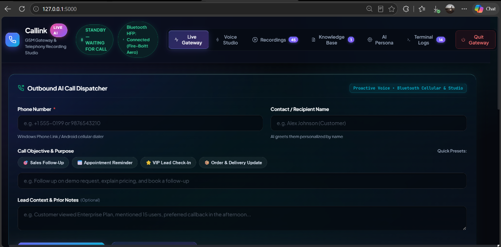
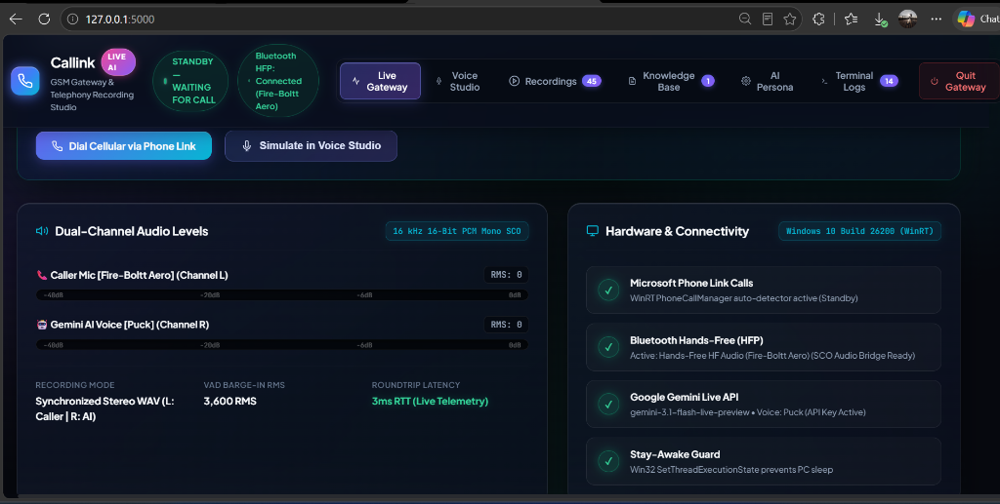

# Callink: GSM-to-Gemini Live AI Voice Gateway & Studio

<div align="center">


-brightgreen?style=for-the-badge)


**A high-performance Windows telephony gateway bridging standard cellular telephone calls directly to Google's multimodal Gemini Live API (`gemini-3.1-flash-live-preview`) over Bluetooth Hands-Free Profile (HFP).**

[Features](#-key-features) • [Live Call Demo](#-real-world-live-call-recording-demo) • [Architecture](#-architecture--telephony-pipeline) • [Latency Benchmark](#-latency-benchmark-callink-vs-legacy-telephony) • [Quickstart](#-quickstart-1-click-on-windows) • [Dashboard Overview](#-glassmorphic-web-dashboard) • [Troubleshooting](#-troubleshooting--audio-tuning)

[](https://callink-website.vercel.app/)

<br><br>



</div>

---

## 🎙️ Real-World Live Call Recording Demo

Experience an actual, unedited ~8-minute cellular phone conversation handled autonomously by Callink and Google's multimodal Gemini Live voice model (`gemini-3.1-flash-live-preview`).

-------------------------------------------------------------------------------------------------______----------------------------------------------------------------

 ## Demo video link --  https://youtu.be/eiAe3MKWJaA?si=rhlqG6b7Zlq0tT4R

------------------------------------------------------------------------------------------------________---------------------------------------------------------------

> **Call Highlights:**
> - **Call Direction:** Autonomous Outbound Cellular Call (placed via Android SIM)
> - **Duration:** 8 minutes 14 seconds
> - **Language:** Hindi & Natural Hinglish dialogue
> - **Latency & Audio:** Direct Bluetooth SCO bridge (~800ms turn-around latency)

https://github.com/user-attachments/assets/7e4e574b-712d-4961-aad7-a972e3ad5125

<br>

<div align="center">

[](https://github.com/user-attachments/assets/7e4e574b-712d-4961-aad7-a972e3ad5125)
[-blue?style=for-the-badge)](https://github.com/Anupthakurr/callink/raw/main/assets/call_demo_outbound.mp3)

</div>


---

## 🌟 What is Callink?

**Callink was created to build an ultra-responsive AI voice calling agent with virtually $0 cost for personal and everyday business use cases.**

Unlike conventional voice AI platforms that force you to buy expensive virtual telephony numbers, SIP trunks, or pay steep per-minute fees to third-party services like **Bolna, Twilio, VoiceLink, or Exotel**, **Callink does NOT require any virtual AI phone number**. Instead, it runs directly on **your own existing smartphone and personal cellular phone number**!

Anyone can call your standard mobile number to converse with your AI agent, and you can dispatch proactive outbound calls straight through your cellular SIM card—without paying a single cent in telephony infrastructure or VoIP subscription charges.

Unlike traditional telephony solutions that require expensive cloud SIP trunks, Asterisk PBX servers, and cascaded STT &rarr; LLM &rarr; TTS pipelines that suffer from 3–5 seconds of awkward conversational delay, **Callink bridges your physical smartphone's Bluetooth baseband audio directly to Google's native speech-to-speech Gemini Live WebSocket gateway on Windows**.

The result is a conversational turn-around latency of **~800ms to 1.2s**, complete with natural barge-in interruptions, multilingual code-switching, automated dual-track recording, and enterprise knowledge grounding.

---

## 🏛️ Architecture & Telephony Pipeline

```text
  +---------------------------------------------------------------------------------------+
  |                               CELLULAR TELEPHONY LAYER                                |
  |                                                                                       |
  |   +-----------------------+              (GSM / VoLTE Carrier Network)                |
  |   | Standard Mobile Phone | <======================================================>  |
  |   | Caller / Recipient    |                                                         | |
  |   +-----------------------+                                                         | |
  |                                                                                     | |
  |                                                                                     v |
  |                                                    +--------------------------------+ |
  |                                                    |     Android Smartphone         | |
  |                                                    |   with "Link to Windows"       | |
  |                                                    +----------------+---------------+ |
  +---------------------------------------------------------------------|-----------------+
                                                                        |
                                         Bluetooth HFP / SCO Audio Link | (16 kHz 16-Bit PCM Bidirectional)
                                         & Phone Link Protocol (tel:)   |
                                                                        v
  +---------------------------------------------------------------------------------------+
  |                          WINDOWS PC GATEWAY HOST (Callink Engine)                     |
  |                                                                                       |
  |   +------------------------------------+    +-------------------------------------+   |
  |   | 1. WinRT Telephony Detector        |    | 2. Proactive Outbound Dialer        |   |
  |   |    PhoneCallManager zero-polling   |    |    Phone Link (tel:) & ADB dialer   |   |
  |   |    automatic call pickup & hangup  |    |    Auto-greeting priming engine     |   |
  |   +-----------------+------------------+    +------------------+------------------+   |
  |                     |                                          |                      |
  |                     +--------------------+---------------------+                      |
  |                                          |                                            |
  |   +--------------------------------------v----------------------------------------+   |
  |   | 3. Bluetooth SCO Audio Bridge (WDM-KS / sounddevice)                          |   |
  |   |    • 20ms hardware audio sampling @ 16 kHz 16-bit mono PCM                   |   |
  |   |    • 150ms dynamic SCO jitter buffer (4,800B) & 100ms frame batcher           |   |
  |   +--------------------------------------+----------------------------------------+   |
  |                                          |                                            |
  |   +--------------------------------------v----------------------------------------+   |
  |   | 4. Hardware-Calibrated VAD & Live Dynamic Barge-In Engine                     |   |
  |   |    • Client-side RMS threshold (Default 2,800 RMS, 6-chunk sustained filter)  |   |
  |   |    • Instant playback queue flush & interrupted turn transcript logger        |   |
  |   +--------------------------------------+----------------------------------------+   |
  |                                          |                                            |
  |   +--------------------------------------v----------------------------------------+   |
  |   | 5. Synchronized Dual-Track Call Recorder & Resampler (audioop / scipy)        |   |
  |   |    • Left: Clean Caller Voice (16kHz) | Right: Gemini AI Voice (16kHz)        |   |
  |   |    • High-fidelity 16 kHz <---> 24 kHz in-memory resampler                    |   |
  |   +--------------------------------------+----------------------------------------+   |
  |                                          |                                            |
  |                     +--------------------+--------------------+                       |
  |                     |                                         |                       |
  |                     v                                         v                       |
  |   +------------------------------------+    +-------------------------------------+   |
  |   | 6. Knowledge Grounding Engine      |    | 7. aiohttp Web Platform & Telemetry |   |
  |   |    In-memory document parser       |    |    Live WebSocket VU meters (L/R)   |   |
  |   |    Zero-latency prompt grounding   |    |    Dual-track player & REST APIs    |   |
  |   +-----------------+------------------+    +------------------+------------------+   |
  |                     |                                          |                      |
  |                     |                                          | HTTP / WebSockets    |
  |                     |                                          v                      |
  |                     |                       +-------------------------------------+   |
  |                     |                       | Obsidian Glassmorphic Web Dashboard |   |
  |                     |                       | (http://localhost:5000)             |   |
  |                     |                       +-------------------------------------+   |
  +---------------------|-----------------------------------------------------------------+
                        |
                        | Bidirectional Secure WebSocket (gemini-3.1-flash-live-preview)
                        v
  +---------------------------------------------------------------------------------------+
  |                              GOOGLE GEMINI LIVE CLOUD                                 |
  |                                                                                       |
  |   • Native Multimodal Speech-to-Speech Engine (Audio In <---> Audio Out)              |
  |   • Real-Time Multilingual Code-Switching (Hindi, English, Hinglish, Maithili, etc.)  |
  |   • Zero-STT / Zero-TTS Architecture (~800ms ultra-low turnaround latency)            |
  +---------------------------------------------------------------------------------------+
```

---

## ⚡ Latency Benchmark: Callink vs. Legacy Telephony

Callink was engineered from first principles to overcome the prohibitive conversational latency inherent in traditional telephony architectures (Asterisk PBX + Twilio/Telnyx SIP trunks + Dograh/LiveKit proxy + cascaded STT &rarr; LLM &rarr; TTS pipelines).

### Performance Breakdown

| Pipeline Stage | Legacy Architecture <br>*(Asterisk + SIP Trunk + STT/LLM/TTS)* | Callink Architecture <br>*(Direct Bluetooth HFP + Gemini Live)* | Latency Eliminated |
| :--- | :--- | :--- | :--- |
| **Call Capture & Ingestion** | **~250 – 400 ms** <br>GSM carrier &rarr; SIP Trunk &rarr; Asterisk PBX &rarr; RTP jitter buffer & transcoding | **~30 – 50 ms** <br>Physical GSM modem &rarr; Bluetooth HFP (SCO link) hardware capture (16 kHz 16-bit PCM) | **~250 – 350 ms** |
| **Telephony Gateway / Proxy** | **~150 – 250 ms** <br>SIP proxy / Dograh webhook overhead, framing & packet forwarding | **0 ms** <br>Completely eliminated (Zero PBX / Zero SIP server) | **~150 – 250 ms** |
| **Speech-to-Text (STT)** | **~400 – 700 ms** <br>Buffer chunk accumulation & text transcription (Whisper / Deepgram) | **0 ms** <br>Eliminated (Direct native audio-in multimodal tokens) | **~400 – 700 ms** |
| **LLM Reasoning & TTFT** | **~800 – 1,500 ms** <br>Text prompt serialization & HTTP stream wait time | **~400 – 600 ms** <br>Native continuous token streaming | **~400 – 900 ms** |
| **Text-to-Speech (TTS)** | **~450 – 800 ms** <br>External TTS buffer synthesis wait (ElevenLabs / Cartesia) | **0 ms** <br>Eliminated (Model directly streams 24 kHz raw PCM audio chunks) | **~450 – 800 ms** |
| **Turn Detection / VAD** | **~600 – 900 ms** <br>Client-side silence threshold wait before dispatching audio to STT | **~350 – 500 ms** <br>Server-side continuous streaming semantic turn detection | **~250 – 400 ms** |
| **Return Audio Streaming** | **~200 – 300 ms** <br>TTS audio &rarr; middleware &rarr; Asterisk RTP &rarr; SIP Trunk carrier | **~30 – 50 ms** <br>Gemini WebSocket chunk &rarr; Windows Bluetooth SCO output queue | **~170 – 250 ms** |
| **TOTAL ROUND-TRIP LATENCY** | **~3,200 – 4,500+ ms (3.2 – 4.5s)** | **~800 – 1,200 ms (0.8 – 1.2s)** | **~2,400 – 3,300 ms saved (~70% to 75% drop)** |

---

## ✨ Key Features

### 1. 💰 $0 Telephony Cost & Runs on Your Own Phone Number
- **Zero Third-Party Telephony Numbers:** No need to buy, configure, or pay monthly subscriptions for virtual phone numbers from **Bolna, Twilio, VoiceLink, Exotel**, or cloud SIP trunk providers.
- **Uses Your Real Cellular SIM:** Runs directly through the SIM card already inside your smartphone using standard carrier voice calling.
- **Trusted Personal Identity:** When you dispatch outbound calls or receive inbound calls, it operates on your real cellular number—never an unknown VoIP or spam-flagged virtual number.

### 2. 📞 Inbound & Outbound Cellular AI Telephony
- **Automatic Inbound Detection:** Automatically answers incoming phone calls via Windows Runtime (`PhoneCallManager`) and starts the AI conversation without manual intervention.
- **Outbound AI Call Dispatcher:** Dispatch proactive outbound calls directly from the web dashboard. Enter the recipient's phone number, name, and conversation goal—the AI dials via Windows Phone Link / Android dialer and speaks first with a tailored greeting!
- **Call Pre-Warming:** Telephony listeners detect incoming rings and pre-initialize WebSocket connections to achieve zero-latency pickup.

### 3. 🌐 Multilingual Auto-Detection & Code-Switching
- **Dynamic Language Detection:** The AI automatically detects the caller's spoken language in real-time (Hindi, English, Spanish, French, German, Japanese, Hinglish, etc.) and naturally matches their language and dialect.
- **Custom Default Language:** Set your business's default conversational language in the dashboard settings with seamless fallback adaptation.

### 4. 🎨 Obsidian Glassmorphic Web Dashboard
- **Futuristic Studio UI:** A sleek dark-mode glassmorphic dashboard (`http://localhost:5000`) built with multi-layer ambient lighting, frosted glass cards, and glowing telemetry nodes.
- **Dual-Channel Live VU Meters:** Real-time LED audio level meters with decibel and RMS readouts for both the caller's microphone and Gemini AI's voice.
- **Live Hardware Nodes:** Instant visual status for Windows Phone Link, Bluetooth HFP SCO bridge, Gemini Live API connection, and Windows Stay-Awake guard.
- **Real-Time Auto-Scrolling Transcripts:** Watch speech bubbles appear live on screen as caller and AI converse.

### 5. 🎙️ Dual-Track Call Recording & Master Web Player
- **Studio-Grade Stereo WAVs:** Every call is automatically recorded to disk (`recordings/`) in synchronized 16 kHz 16-bit stereo WAV format:
  - **Left Channel (L):** Isolated caller microphone.
  - **Right Channel (R):** Isolated Gemini AI voice.
- **Master Audio Player with Channel Isolation:** Built-in Web Audio API player allows you to toggle **Stereo (Dual)**, isolate **Caller Only**, isolate **AI Only**, or blend to **Mixed Mono** with playback speed control (0.75x – 2.0x).
- **JSON Metadata & Transcripts:** Full timestamped JSON transcripts saved alongside every WAV recording.

### 6. 🧠 Instant In-Browser Voice Studio
- Talk directly to the Gemini Live AI voice agent in your browser using your PC's microphone and speakers.
- Perfect for testing prompts, rehearsing outbound scripts, or testing document knowledge without dialing a phone number.

### 7. 📚 Zero-Latency Business Knowledge Base Grounding
- Upload business documents (`.pdf`, `.docx`, `.txt`, `.md`, `.csv`, `.json`) directly through the web UI.
- Text is automatically extracted, tokenized, and injected straight into Gemini Live's system context.
- Provides grounded, accurate answers on pricing, business policies, menus, and support questions with **zero vector database lookup latency**.

### 8. 🛡️ Enterprise Hardware Resilience
- **Anti-Cut Barge-In Engine:** Calibrated client-side RMS speech detection and immediate audio playback buffer purging allows callers to interrupt the AI naturally.
- **Windows Stay-Awake Guard:** Integrated with Win32 `kernel32.SetThreadExecutionState` (`ES_SYSTEM_REQUIRED | ES_AWAYMODE_REQUIRED`) to prevent PC/laptop sleep and keep Bluetooth and network links alive 24/7.
- **150ms Dynamic SCO Jitter Buffer (4,800 Bytes):** Absorbs network and Bluetooth packet jitter on Windows for smooth, continuous, glitch-free telephony playback.

---

## 💻 Hardware & System Requirements

| Component | Minimum Specification | Recommended Specification |
| :--- | :--- | :--- |
| **Operating System** | Windows 10 (64-bit, build 19041+) | Windows 11 (64-bit, latest build) |
| **Smartphone** | Android smartphone with active cellular SIM | Android 10+ with active SIM & Bluetooth 5.0+ |
| **PC Bluetooth** | Bluetooth 4.2 adapter | Bluetooth 5.0+ USB dongle or internal card |
| **Companion Software** | Microsoft **Phone Link** on PC <br>Microsoft **Link to Windows** on Android | Pre-installed on Windows 10/11 <br>Available free on Google Play Store |
| **API Credentials** | Google Gemini API Key | High-quota key from [Google AI Studio](https://aistudio.google.com/) |

> [!IMPORTANT]
> Both devices must be paired through **Phone Link** with the **Calls** feature enabled. This activates the required `Hands-Free HF Audio` Bluetooth SCO endpoints in Windows Sound Settings and allows Windows `PhoneCallManager` to detect cellular telephone events.

---

## 🚀 Quickstart (1-Click on Windows)

### Option 1: Standalone Single Executable (`Callink_v2.1.exe`) — Zero Python Required!
If you want to run Callink or share it with others who don't have Python installed:
1. Double-click **`Callink_v2.1.exe`** (or `Callink.exe`) in the repository root or download from GitHub Releases.
2. On first launch, if your API key isn't configured, enter your `GEMINI_API_KEY` when prompted.
3. The dashboard opens automatically at **`http://localhost:5000`**!

### Option 2: 1-Click Batch Runner (`run.bat`)
1. Clone this repository:
   ```bash
   git clone https://github.com/Anupthakurr/callink.git
   cd callink
   ```
2. Double-click **`run.bat`**:
   - Automatically detects Python 3.9+.
   - Prompts for your `GEMINI_API_KEY` on first launch and writes `.env`.
   - Creates a clean isolated virtual environment (`venv`) and installs dependencies.
   - Launches the gateway and web dashboard.

---

## 🛠️ Manual Installation & Developer Setup

### 1. Clone & Setup Virtual Environment
```bash
git clone https://github.com/Anupthakurr/callink.git
cd callink

python -m venv venv
# On Windows PowerShell:
.\venv\Scripts\Activate.ps1
# On Windows CMD:
venv\Scripts\activate.bat
```

### 2. Install Dependencies
```bash
pip install -r requirements.txt
```

### 3. Configure Environment Variables
Copy `.env.example` to `.env`:
```bash
copy .env.example .env
```
Add your Gemini API key:
```env
GEMINI_API_KEY=your_actual_gemini_api_key_here
```

### 4. Pair Your Android Phone with Windows Phone Link
1. On your Windows PC, open **Phone Link**.
2. On your Android phone, install and open **Link to Windows**.
3. Follow the on-screen instructions to pair via Bluetooth.
4. In Phone Link, click **Calls** in the sidebar, click **Get Started**, and grant call permissions on your phone.
5. In Windows Sound Settings, verify that **Hands-Free HF Audio** appears under Input and Output devices.

### 5. Launch the Gateway
```bash
python gsm_gemini_gateway.py
```
Open **`http://localhost:5000`** in your browser.

---

## 🖥️ Glassmorphic Web Dashboard

<p align="center">
  
  <br><em>Figure 1: Proactive Outbound AI Call Dispatcher with Quick Purpose Presets & Contact Context</em>
</p>

<p align="center">
  
  <br><em>Figure 2: Real-Time Dual-Channel VU Audio Meters (Caller vs. AI) & WinRT Hardware Connectivity Nodes</em>
</p>

The web dashboard is organized into 5 dedicated studio suites:

```
+-----------------------------------------------------------------------------------------+
| [📞 Callink LIVE AI]  (STANDBY - WAITING)  (Bluetooth HFP: Connected)  [Quit Gateway]    |
| [ ~ Live Gateway ] [ 🎙️ Voice Studio ] [ ⏯️ Recordings (18) ] [ 📄 Knowledge (1) ] [ ⚙️ AI Persona ] |
+-----------------------------------------------------------------------------------------+
```

1. **Live Gateway (`#paneTelemetry`)**:
   - **Outbound AI Call Dispatcher:** Enter phone number, recipient name, select one of the quick goal chips (🎯 Sales Follow-Up, 📅 Appointment Reminder, ⭐ VIP Lead Check-In, 📦 Order & Delivery), or type a custom goal.
   - **Dual-Channel VU Meters:** Live audio activity bars with RMS meter metrics.
   - **Hardware Connectivity:** Telephony status, Bluetooth HFP bridge, Gemini Live connection, and Stay-Awake status.
   - **Live Conversation Stream:** Real-time speech bubbles and event timestamps.

2. **Voice Studio (`#paneStudio`)**:
   - Test conversational interactions directly using your computer's mic and speaker.
   - Features animated pulsating audio orb, real-time waveform, and session recording.

3. **Recordings Library (`#paneRecordings`)**:
   - **Master Audio Player:** Interactive scrub slider, playback speed controls (0.75x - 2.0x), and WAV downloads.
   - **Hardware Channel Isolation:** Listen to `Stereo (Dual)`, `Caller Only (L)`, `AI Only (R)`, or `Mixed Mono`.
   - Complete history of all calls with metadata cards and synchronized JSON transcripts.

<p align="center">
  
  <br><em>Figure 3: Synchronized Stereo WAV Recordings Player with Web Audio Channel Isolation (Left / Right / Mono)</em>
</p>

4. **Knowledge Base (`#paneKnowledge`)**:
   - Drag-and-drop document upload area supporting PDF, DOCX, TXT, Markdown, CSV, and JSON up to 20MB.
   - Real-time token context calculation and in-memory injection into Gemini Live system prompt.
   - **Inspect Injected Prompt:** Preview the exact grounding prompt injected into active sessions.

<p align="center">
  
  <br><em>Figure 4: Enterprise Document Grounding with Zero-Latency In-Memory Context Injection</em>
</p>

5. **AI Persona & Settings (`#paneSettings`)**:
   - **Voice Persona Selector:** Choose between `Puck`, `Charon`, `Aoede`, `Fenrir`, or `Kore`.
   - **Default Language:** Auto-detect caller dialect or configure fixed defaults (Hindi, English, Spanish, etc.).
   - **System Instruction Templates:** One-click pre-built templates for Receptionist, Sales, Support, and Scheduling.
   - **Barge-In Calibration:** Fine-tune VAD RMS threshold and speech start grace period.

<p align="center">
  
  <br><em>Figure 5: Gemini Live Voice Persona, Hindi/Multilingual Defaults & System Instruction Templates</em>
</p>

---

## 📦 Building Standalone Executable (`Callink_v2.1.exe`)

To package the entire Python runtime, dependencies, and web platform into a single distributable Windows `.exe`:

```bash
# Run the automated v2.1 build script:
build_v2_1_exe.bat
```
*Or manually with PyInstaller:*
```bash
pyinstaller --noconfirm Callink_v2_1.spec
```

The resulting binary will be generated in `dist\Callink_v2.1.exe`. It can be run on any 64-bit Windows 10/11 PC with zero prerequisites.

---

## 🔧 Troubleshooting & Audio Tuning

### 1. "Bluetooth Hands-Free device not found"
- Ensure your phone is paired in Windows **Phone Link** and that the **Calls** feature is active.
- On Android, go to **Settings &rarr; Bluetooth &rarr; Your PC**, tap the gear icon, and ensure **Phone calls** is toggled ON.
- Ensure the Bluetooth Hands-Free Audio driver (`bthhfenum.sys`) is active and not disabled in Device Manager.

### 2. Audio Echo or Beeping on Laptop Speakers
- During phone calls, audio is routed bidirectionally between your phone's cellular baseband modem and your PC's Bluetooth Hands-Free device (`Hands-Free HF Audio`).
- If you want to listen to live calls without disturbing the caller, use headphones or adjust device volume in Windows Sound Settings to prevent acoustic feedback loop into the microphone.

### 3. Phone Link "Transfer to PC" Frozen or Phone Audio Selector Stuck
- **Symptom:** During an incoming or active cellular call, clicking **"Transfer to PC"** in Microsoft Phone Link is completely unresponsive / frozen, and the in-call audio output selector on the smartphone screen (Earpiece / Speaker / Bluetooth) is also grayed out or frozen.
- **Root Cause:** Windows Bluetooth HFP (`bthhfenum.sys`) is an exclusive kernel driver for Synchronous Connection-Oriented (SCO) audio. If two Callink instances run simultaneously (process collision) or an audio stream is opened before SCO negotiation completes, the kernel driver enters a desynchronized "ghost" state (`DeviceIoControl GLE = 0x00000001`). When an audio transfer is attempted, the Bluetooth driver hangs waiting for an unacknowledged handshake, freezing both the Phone Link UI thread and Android's telephony audio routing manager.
- **Resolution (2-Minute Clean Reset):**
  1. **Ensure Single Instance:** Confirm only one Callink instance is active. Terminate any orphan processes via Task Manager or `taskkill /F /IM Callink.exe`.
  2. **Unpair on Smartphone:** On your Android phone, go to **Settings &rarr; Bluetooth &rarr; Your PC**, tap the settings/info icon, and select **Unpair / Forget**.
  3. **Remove Device on PC:** In Windows **Settings &rarr; Bluetooth & devices &rarr; Devices**, locate your smartphone, click the three dots (`...`), and select **Remove device**.
  4. **Re-Pair via Phone Link Calls Wizard (Crucial):** Open the **Phone Link** app on your PC, navigate to the **Calls** tab in the sidebar, and click **"Set up"** or **"Get Started"**. Complete the pairing wizard directly through Phone Link (rather than standard Windows Bluetooth settings) so that Windows telephony cleanly registers the HFP profile and generates fresh SCO encryption keys.

### 4. Tuning Conversational Barge-In (Interruption Sensitivity)

**Barge-In** is the mechanism that allows callers to naturally interrupt the AI agent mid-sentence - just like a real human conversation. When the caller speaks while the AI is talking, Callink instantly detects the caller's voice and stops AI playback so the caller can be heard.

Open the dashboard at `http://localhost:5000` => **AI Persona & Settings** tab to configure.

---

#### Barge-In Sensitivity (RMS Threshold) - What It Does

The **RMS Threshold** is the loudness level that a caller's voice must exceed before Callink registers it as a genuine interruption and stops the AI.

| Slider Position | RMS Value | Behavior | Best For |
|:---|:---|:---|:---|
| **Low** | `600 - 1,500` | **Highly sensitive** - AI stops even on soft murmurs, whispers, or a quiet hmm | Silent/quiet indoor rooms |
| **Medium (Default)** | `2,500 - 3,600` | **Balanced** - Triggers on normal conversational voice, ignores background hiss | Standard calls (recommended) |
| **High** | `5,000 - 6,000` | **Noise-resistant** - Only very loud, clear speech triggers interruption | Outdoor / noisy environments |

> **Recommended: Default 2,800 RMS (Calibrated Noise-Immune Range: 2,500 - 3,200 RMS)**
>
> On cellular calls over Bluetooth HFP:
> - Ambient Bluetooth line noise, fans, and breathing typically register in the **600 - 1,400 RMS** range.
> - Genuine conversational caller voice typically registers in the **2,500 - 4,500+ RMS** range.
> - Too **high** (5,000+): Caller's normal voice never triggers barge-in => AI keeps talking **over** the caller.
> - Too **low** (< 1,000): Bluetooth SCO background hiss or carrier tones may falsely interrupt the AI.
>
> **Start at `2,500 RMS` and increase by 500 if you experience false interruptions.**

---

#### Quick Reference by Environment

| Environment | Recommended RMS |
|:---|:---:|
| Quiet room / indoors | **2,000 - 3,000** |
| Office with background chatter | **3,000 - 4,000** |
| Outdoor / street noise | **4,000 - 5,000** |
| Very loud environment (traffic, construction) | **5,000 - 6,000** |

---

#### Barge-In Grace Period (`0.10s - 0.50s`)

Defines the initial delay after the AI **starts speaking** before caller interruptions are processed.

- **Purpose:** Prevents the AI's own synthesized voice from acoustically looping back through the Bluetooth mic and self-triggering a false interruption at the very start of speaking.
- **Short Grace (`0.10s`):** Interruption is allowed almost immediately. Caller can cut in very early.
- **Long Grace (`0.50s`):** AI gets a 500ms protected window to begin speaking before barge-in activates.
- **Recommended:** `0.50s` (500ms) - provides a protected opening window to deliver initial sentences cleanly without premature cutoff.

---

#### How Barge-In Works Internally

Barge-In uses a **dual-detection system** (client-side + server-side):

1. **Client-Side RMS Detection** (`gemini_live_bridge.py` => `sender()`):
   Every 20ms audio frame from the Bluetooth mic is measured for loudness (RMS). If `caller_rms > vad_threshold` for **6 consecutive frames (~120ms)** => `bridge.clear_playback()` is called, draining the AI audio buffer and stopping playback instantly.

2. **Server-Side Interruption** (Gemini Live API):
   Gemini Live's built-in VAD (`END_SENSITIVITY_HIGH`) also detects caller speech server-side and signals `server_content.interrupted = True`, providing a secondary safety net.

### 5. AI Voice Cutting Out on Background Noise or Sounding Choppy / Broken
- **Symptom:** AI stops speaking prematurely upon slight ambient noise (fans, air conditioning, breathing), or synthesized speech sounds stuttered, choppy, or cracked over Bluetooth SCO.
- **Root Cause:**
  1. **Hyper-Sensitive VAD:** When `vad_threshold` is set too low (< 1,500 RMS) with a tight trigger window (2 frames / 40ms), ambient noise continuously triggers client-side barge-in, abruptly draining the playback buffer mid-sentence.
  2. **Jitter Cushion Starvation:** When packet buffers are below 100ms, normal WebSocket cloud packet jitter across the internet starves the PortAudio playback DAC, outputting zero-byte silence blocks that sound like voice breaks.
- **Resolution:**
  1. **Calibrated VAD Threshold (`2,800 RMS`):** Ambient Bluetooth line hiss (800-1,200 RMS) is ignored while conversational caller voice (> 2,500 RMS) triggers clean interruptions.
  2. **Multi-Frame Sustained Speech Window (6 chunks / ~120ms):** Transient audio clicks, breaths, or ambient noise spikes are ignored unless speech is sustained.
  3. **150ms DynamicSCO Pre-Buffer Cushion (`4,800 bytes`):** Holds 150ms of audio before starting DAC output, absorbing internet latency spikes and ensuring 100% continuous, crystal-clear voice streaming with zero stuttering.
  4. **0.50s Barge-In Grace Window:** Protects the initial sentence delivery from premature acoustic self-interruption.

### 6. Preventing Windows Sleep During Standby
Callink automatically invokes `SetThreadExecutionState` on startup to keep the PC active while waiting for cellular calls. If using a laptop on battery, ensure Windows Power & Battery settings allow background network activity when the lid is closed.

---

## 📁 Repository Structure & Code Metrics

```text
callink/                                        # Total Codebase: ~10,466+ Lines of Code
├── assets/                                     # Dashboard UI previews, architecture diagrams & audio demos
│   ├── call_demo_outbound.mp3                  # Streamable live call recording demo
│   ├── call_demo_outbound.mp4                  # Embedded video player demo
│   └── dashboard_*.png                         # Obsidian Glassmorphic dashboard screenshots
├── web/                                        # Modern Obsidian Glassmorphic Web Dashboard (5,933 LOC)
│   ├── index.html                              # Main dashboard layout & 5 studio suites (819 LOC)
│   ├── styles.css                              # Obsidian Glassmorphic 2.0 design system (2,806 LOC)
│   └── app.js                                  # Frontend WebSocket client, Web Audio player & UI logic (2,308 LOC)
├── gsm_gemini_gateway.py                       # Core application orchestrator, single instance & standby loop (754 LOC)
├── audio_bridge.py                             # Bluetooth SCO audio bridge (PortAudio WDM-KS & WASAPI) (890 LOC)
├── gemini_live_bridge.py                       # Gemini Live WebSocket streaming, VAD barge-in & session manager (726 LOC)
├── audio_resampler.py                          # 16 kHz <-> 24 kHz in-memory continuous rate converter (36 LOC)
├── power_guard.py                              # Windows Stay-Awake / Sleep prevention watchdog (40 LOC)
├── phone_audio_silencer.py                     # Microsoft Phone Link audio silencer & desktop VoIP detector (106 LOC)
├── outbound_dialer.py                          # Outbound cellular dialing via Phone Link & Android ADB (321 LOC)
├── call_recorder.py                            # Dual-track stereo WAV recorder & transcript logger (236 LOC)
├── knowledge_manager.py                        # Enterprise document parser (.pdf, .docx, .txt) & prompt injector (342 LOC)
├── web_server.py                               # Aiohttp server, real-time WebSocket gateway & REST APIs (986 LOC)
├── security_guard.py                           # Anti-tamper & enterprise security watchdog (96 LOC)
├── build_v2_1_exe.bat                          # 1-Click v2.1 enterprise executable compilation script (47 LOC)
├── Callink_v2_1.spec                           # PyInstaller v2.1 standalone executable specification (96 LOC)
├── build_exe.bat                               # 1-Click legacy PyInstaller compilation script (45 LOC)
├── Callink.spec                                # Legacy PyInstaller standalone specification (92 LOC)
├── run.bat                                     # 1-Click Windows environment launcher & auto-setup (76 LOC)
├── requirements.txt                            # Python dependencies specification
├── .env.example                                # Environment configuration template (GEMINI_API_KEY)
├── settings.json                               # Persisted persona & VAD configuration (auto-generated)
├── recordings/                                 # Dual-track stereo WAV call archives & transcripts (auto-generated)
└── knowledge/                                  # Uploaded enterprise grounding documents (auto-generated)
```

### 🗂️ Component & Architecture Responsibilities

| Component / File | LOC | Key Functions & Methods Handled | Primary Responsibility & Technical Implementation |
| :--- | :---: | :--- | :--- |
| **`gsm_gemini_gateway.py`** | **754** | `main()`, `main_async()`, `watch_call_and_hfp()`, `ensure_single_instance()`, `ensure_gemini_api_key()` | **Master Application Orchestrator:** Manages process single-instance Win32 mutex locks, initializes COM single-threaded apartments, monitors physical cellular call state transitions via WinRT (`Windows.ApplicationModel.Calls.PhoneCallManager`), and orchestrates the standby polling loop, pre-warming triggers, and active call lifecycle. |
| **`audio_bridge.py`** | **890** | `find_hfp_devices()`, `find_active_bthhfenum_endpoints()`, `HFPBridge.start()`, `HFPBridge.stop()`, `HFPBridge.is_healthy()`, `HFPBridge.input_callback()`, `HFPBridge.output_callback()`, `HFPBridge.push_playback_audio()`, `HFPBridge.flush_turn_playback()`, `HFPBridge.clear_playback()`, `HFPBridge.has_pending_playback()`, `HFPBridge.get_audio_levels()` | **Bluetooth SCO Hardware Audio Bridge:** Implements direct PortAudio WDM-KS kernel streaming (`sounddevice`) to `bthhfenum.sys` with native WASAPI COM fallback. Manages bidirectional 16 kHz 16-bit PCM frames (20ms / 320 samples), dynamic 150ms SCO jitter buffer (4,800 bytes cushion), and edge-cosine anti-crackle playback smoothing. |
| **`gemini_live_bridge.py`** | **726** | `run_gemini_bridge()`, `resample_for_hfp()`, `GeminiPrewarmer.start_prewarm()`, `GeminiPrewarmer.acquire_session()`, `GeminiPrewarmer.release()`, `GeminiPrewarmer.is_ready()`, `GeminiPrewarmer.is_active()`, `GeminiPrewarmer._worker()` | **Gemini Live AI WebSocket Pipeline:** Handles real-time bidirectional WebSocket audio streaming to Google's `gemini-3.1-flash-live-preview`. Executes 100ms audio frame batching, performs hardware-calibrated client-side RMS speech barge-in detection (`vad_threshold=2800`), pre-warms sessions during cellular ring, and injects conversation history on reconnects. |
| **`audio_resampler.py`** | **36** | `resample_for_hfp()`, `HFPResampler.resample()`, `HFPResampler.reset()` | **High-Fidelity Audio Resampler:** Performs continuous state-preserved sample rate conversion between 24 kHz (Gemini output) and 16 kHz (Bluetooth telephony) using `audioop.ratecv` with zero clicking, distortion, or phase artifacts. |
| **`power_guard.py`** | **40** | `prevent_sleep()`, `start_stay_awake_heartbeat()`, `allow_sleep()` | **Windows Power & Stay-Awake Guard:** Interacts with `kernel32.SetThreadExecutionState` (`ES_SYSTEM_REQUIRED | ES_DISPLAY_REQUIRED | ES_CONTINUOUS`) with a 15-second heartbeat thread to keep CPU, network, and Bluetooth endpoints active 24/7 without entering system sleep. |
| **`phone_audio_silencer.py`** | **106** | `set_phone_link_audio_silenced()`, `is_pc_voip_call_active()`, `PhoneLinkAudioSilencer.start()`, `PhoneLinkAudioSilencer.stop()`, `PhoneLinkAudioSilencer._run()` | **Audio Loopback Silencer:** Uses Windows Core Audio (`pycaw`) and `psutil` to mute Phone Link's (`PhoneExperienceHost.exe`) speaker and microphone sessions to eliminate room echo and feedback screech, and detects active PC VoIP calls. |
| **`outbound_dialer.py`** | **321** | `start_outbound_dial()`, `cancel_outbound_dial()`, `trigger_system_dialer()`, `hangup_current_call()`, `clean_phone_number()`, `format_e164_number()`, `get_active_outbound()`, `consume_active_outbound()`, `build_outbound_context()`, `build_outbound_proactive_prompt()`, `is_phone_link_call_connected()`, `is_phone_link_call_present()`, `is_call_transferred_to_pc()`, `trigger_transfer_to_pc_async()`, `find_phone_link_window()` | **Proactive Cellular Outbound Calling:** Dispatches cellular calls via Windows Phone Link protocol (`tel:`) and Android ADB, validates audio transfer states, and primes Gemini Live with an outbound conversational role and instant proactive greeting trigger. |
| **`call_recorder.py`** | **236** | `get_all_recordings()`, `delete_recording()`, `CallRecorder.start()`, `CallRecorder.write_stereo_block()`, `CallRecorder.add_transcript()`, `CallRecorder.add_event()`, `CallRecorder.finish()`, `CallRecorder.get_summary()` | **Dual-Track Stereo WAV Recorder:** Captures synchronized dual-channel 16 kHz 16-bit audio (Left: Caller mic, Right: AI audio) to disk, generates metadata cards, and saves timestamped conversational dialogue JSON transcripts. |
| **`knowledge_manager.py`** | **342** | `extract_text_from_file()`, `add_document()`, `delete_document()`, `toggle_document()`, `get_all_documents()`, `get_document_full()`, `get_knowledge_summary()`, `build_knowledge_prompt()`, `get_effective_system_instruction()`, `load_documents_metadata()`, `save_documents_metadata()` | **Business Document Grounding:** Ingests multi-format business files (`.pdf`, `.docx`, `.txt`, `.md`, `.csv`, `.json`), calculates token budgets, formats document boundaries, and injects context directly into Gemini Live's system prompt in-memory with zero vector database lookup latency. |
| **`web_server.py`** | **986** | `setup_routes()`, `handle_index()`, `handle_get_status()`, `handle_get_recordings()`, `handle_get_recording_audio()`, `handle_get_recording_json()`, `handle_delete_recording()`, `handle_post_dial()`, `handle_post_dial_cancel()`, `handle_get_dial_status()`, `handle_get_knowledge_docs()`, `handle_post_knowledge_upload()`, `handle_delete_knowledge_doc()`, `handle_toggle_knowledge_doc()`, `handle_get_knowledge_preview()`, `handle_get_knowledge_summary()`, `handle_get_settings()`, `handle_post_settings()`, `handle_post_shutdown()`, `handle_get_logs()`, `handle_clear_logs()`, `broadcast_terminal_logs()`, `handle_ws_telemetry()`, `broadcast()`, `update_audio_levels()`, `handle_ws_browser_call()`, `set_in_call_state()`, `probe_hardware_sync()`, `check_hfp_hardware()`, `load_settings()`, `save_settings()` | **Asynchronous Web Platform & Telemetry Gateway:** High-performance `aiohttp` server hosting the web platform, handling real-time WebSockets for live VU meters and speech transcripts, serving REST APIs for recordings, knowledge files, and AI persona settings, and running the in-browser Voice Studio. |
| **`security_guard.py`** | **96** | `start_security_watchdog()`, `enforce_security()`, `is_debugger_present()`, `is_forbidden_tool_running()`, `_watchdog_loop()` | **Anti-Tamper & Security Watchdog:** Protects compiled binaries against reverse-engineering, process injection, active debuggers (`x64dbg`, `IDA Pro`, `Cheat Engine`), and unauthorized runtime tampering. |
| **`web/ (Frontend Suite)`** | **5,933** | `index.html (819 LOC)`, `styles.css (2,806 LOC)`, `app.js (2,308 LOC)` | **Obsidian Glassmorphic 2.0 Dashboard:** Complete frontend studio featuring 5 suites (Live Gateway, Voice Studio, Recordings Player, Knowledge Base, AI Persona), Web Audio API channel isolation, pulsating audio orb, and real-time WebSocket client. |
| **`run.bat`** | **76** | `Automated launcher & venv setup` | Automatically validates Python 3.9+, initializes virtual environment (`venv`), installs dependencies, prompts for `GEMINI_API_KEY` on first launch, and opens the dashboard. |
| **`build_v2_1_exe.bat & Callink_v2_1.spec`** | **143** | `Automated PyInstaller & PyArmor build script` | Bundles complete Python runtime, security guard, and web platform into standalone zero-dependency `Callink_v2.1.exe`. |
| **`assets/`** | **—** | `Media Demos & Visuals` | Stores dashboard UI screenshots, architectural diagrams, and sample streamable call recordings (`call_demo_outbound.mp3`, `call_demo_outbound.mp4`). |
| **`recordings/ (Runtime)`** | **—** | `Automated Call Storage` | Automatically created directory where synchronized stereo WAV call recordings and JSON transcripts are archived. |
| **`knowledge/ (Runtime)`** | **—** | `Enterprise Document Store` | Automatically created directory housing uploaded business documents for prompt injection. |
| **`settings.json (Runtime)`** | **—** | `Persisted Configuration` | Stores user-configured AI persona, selected voice, barge-in RMS threshold, grace periods, and language defaults. |

### 🔬 Detailed Function & Method Reference (By File)

This section provides an exhaustive reference of all top-level functions and class methods across every module in Callink, detailing their specific operational responsibilities, inputs, and architectural mechanics.

---

#### 1. `gsm_gemini_gateway.py` (754 LOC) — *Master Application Orchestrator*
* **`main()`**: Process bootstrap entry point; invokes `asyncio.run(main_async())` inside an OS-level exception handler to guarantee clean shutdown on SIGINT or unhandled exceptions.
* **`main_async()`**: Master asynchronous event loop orchestrator. Initializes Windows COM single-threaded apartments, spawns the high-performance `aiohttp` web server, enforces process single-instance mutual exclusion, launches the stay-awake power guard, and coordinates the cellular call standby loop. Dynamically manages call pickup, pre-warmed session acquisition, and graceful teardown upon call termination.
* **`watch_call_and_hfp()`**: Standby hardware polling loop running every 1.5s. Interrogates WinRT Telephony APIs (`PhoneCallManager`) and Bluetooth device registries. Detects incoming rings, triggers the Gemini pre-warmer, and yields call state transitions (`RINGING`, `CONNECTED`, `ENDED`) to the active call handler.
* **`ensure_single_instance()`**: Creates a named Win32 kernel Mutex (`Global\\Callink_GSM_Gateway_Mutex`). If another instance of Callink is active, displays a warning dialog and cleanly exits to prevent dual-process audio and hardware driver conflicts.
* **`ensure_gemini_api_key()`**: Validates that a valid Google Gemini API key is present in environment variables, `.env`, or `settings.json`. If missing on first launch, prompts the user via terminal and saves it securely.
* **`TeeLogger.write(data) & TeeLogger.flush()`**: Custom stream interceptor replacing `sys.stdout` and `sys.stderr`. Appends console output to an in-memory ring buffer and dispatches live log entries over WebSockets to the web dashboard.

---

#### 2. `audio_bridge.py` (890 LOC) — *Bluetooth SCO Hardware Audio Bridge*
* **`find_hfp_devices()`**: Enumerates all Windows audio endpoints via `sounddevice` / PortAudio, filtering specifically for Bluetooth Hands-Free Profile (HFP) input and output endpoints. Prioritizes low-latency direct WDM-KS (`Windows DirectSound / Kernel Streaming`) over WASAPI/MME.
* **`find_active_bthhfenum_endpoints()`**: Low-level Windows COM MMDevice enumerator that inspects `bthhfenum.sys` registry endpoints to locate active Bluetooth SCO audio render and capture pins directly.
* **`HFPBridge.start()`**: Initializes bidirectional audio streams (16 kHz, 16-bit PCM, mono) using either native low-latency WASAPI COM worker threads or PortAudio stream callbacks based on hardware capability.
* **`HFPBridge.stop()`**: Atomically drains pending buffers, halts worker capture/render loops, terminates PortAudio streams, and releases hardware COM endpoint interfaces.
* **`HFPBridge.is_healthy()`**: Diagnostic watchdog verifying that both capture and render streams are running and delivering valid audio frames without buffer underflows or hardware drops.
* **`HFPBridge.input_callback(indata, frames, time_info, status)`**: High-frequency PortAudio capture callback; receives 20ms incoming caller microphone audio chunks over Bluetooth SCO, computes RMS energy for live VU meters, and pushes frames into the upstream queue for Gemini Live.
* **`HFPBridge.output_callback(outdata, frames, time_info, status)`**: PortAudio playback callback; pulls synthesized AI audio from the jitter buffer, applies cosine-window anti-crackle envelope smoothing, and feeds frames to the Bluetooth phone link speaker.
* **`HFPBridge.push_playback_audio(pcm_data)`**: Receives resampled 16 kHz audio chunks from Gemini Live, appends them to the playback queue, and releases buffering once the 150ms SCO cushion (4,800 bytes) threshold is achieved.
* **`HFPBridge.flush_turn_playback()`**: Triggered when Gemini signals `turn_complete`; forces any remaining buffered audio to render through the speaker immediately, preventing trailing words from being clipped.
* **`HFPBridge.clear_playback()`**: Flushes and empties the playback buffer instantaneously when caller speech is detected, executing zero-latency barge-in interruption.
* **`HFPBridge.has_pending_playback()`**: Returns `True` if audio frames are queued or currently rendering through the speaker DAC.
* **`HFPBridge.get_audio_levels()`**: Returns instantaneous input (caller) and output (AI) RMS audio levels for the dashboard telemetry meter.
* **`HFPBridge._capture_worker() & HFPBridge._render_worker()`**: Low-level native WASAPI COM thread implementations that read and write audio buffers via `IAudioCaptureClient` and `IAudioRenderClient` with direct hardware clock timing.

---

#### 3. `gemini_live_bridge.py` (726 LOC) — *Gemini Live AI WebSocket Pipeline*
* **`run_gemini_bridge(hfp_bridge, outbound_info, recorder, ...)`**: Primary live session manager for an active call. Establishes a bidirectional WebSocket connection to Google's `gemini-3.1-flash-live-preview`, configures voice, system instructions, and tools, and manages concurrent async tasks for audio streaming, response handling, and barge-in monitoring.
* **`resample_for_hfp(audio_24k)`**: Standalone rate converter taking 24 kHz mono PCM from Gemini and resampling to 16 kHz for telephony via `audioop.ratecv`.
* **`GeminiPrewarmer.start_prewarm()`**: Initiates a background WebSocket handshake to Gemini Live as soon as an incoming or outgoing call begins ringing.
* **`GeminiPrewarmer.acquire_session()`**: Hands over the pre-warmed, fully authenticated WebSocket session as soon as the call connects, shaving 800ms to 1.5s off the initial conversational greeting latency.
* **`GeminiPrewarmer.release()`**: Cleans up and disconnects any pre-warmed session if a call is declined, missed, or canceled before connecting.
* **`GeminiPrewarmer.is_ready() & GeminiPrewarmer.is_active()`**: Query methods checking whether a pre-warmed session is currently established or actively connecting in the background.
* **`GeminiPrewarmer._worker()`**: Background worker coroutine that performs the TLS handshake, sets session configuration (voice, system instructions, tools), and holds the connection ready.

---

#### 4. `audio_resampler.py` (36 LOC) — *High-Fidelity Audio Resampler*
* **`resample_for_hfp(audio_24k)`**: Convenience functional wrapper around `HFPResampler.resample()`.
* **`HFPResampler.__init__()`**: Initializes rate conversion filter state (`state = None`).
* **`HFPResampler.resample(audio_data)`**: Converts 24 kHz audio blocks to 16 kHz using Python's native `audioop.ratecv`, preserving internal filter state across chunk boundaries to completely eliminate clicks, pops, and phase artifacts.
* **`HFPResampler.reset()`**: Resets filter state between separate call turns.

---

#### 5. `power_guard.py` (40 LOC) — *Windows Power & Stay-Awake Guard*
* **`prevent_sleep()`**: Invokes Windows Win32 API `kernel32.SetThreadExecutionState` with flags `ES_SYSTEM_REQUIRED | ES_DISPLAY_REQUIRED | ES_CONTINUOUS` to prevent Windows from entering sleep or idle throttling.
* **`start_stay_awake_heartbeat()`**: Spawns a background daemon thread that periodically re-asserts execution state flags every 15 seconds, preventing laptops or desktops from suspending audio threads during standby.
* **`allow_sleep()`**: Clears the execution state flags, restoring normal Windows power and sleep behavior upon application exit.

---

#### 6. `phone_audio_silencer.py` (106 LOC) — *Audio Loopback Silencer*
* **`is_pc_voip_call_active()`**: Checks Windows audio sessions and running processes (`WhatsApp.exe`, `Teams.exe`, `Zoom.exe`, `Skype.exe`, `Telegram.exe`) to prevent silencing if the user is in an active PC desktop meeting.
* **`set_phone_link_audio_silenced(silenced)`**: Interacts with Windows Core Audio endpoints via `pycaw` to locate `PhoneExperienceHost.exe` audio sessions and dynamically mute/unmute its speaker and mic feeds, eliminating acoustic feedback loops while Callink handles SCO audio.
* **`PhoneLinkAudioSilencer.start()`**: Launches the background audio watchdog loop.
* **`PhoneLinkAudioSilencer.stop()`**: Halts the watchdog and un-mutes Phone Link audio sessions.
* **`PhoneLinkAudioSilencer._run()`**: Continuous polling thread checking every 2 seconds to ensure Phone Link remains muted throughout active cellular calls.

---

#### 7. `outbound_dialer.py` (321 LOC) — *Proactive Cellular Outbound Calling*
* **`start_outbound_dial(phone_number, prompt_override, ...)`**: Records outbound dialing intent, formats the recipient number to E.164, and initiates dialing via system protocol or ADB.
* **`cancel_outbound_dial()`**: Aborts a pending outbound call and cleans up dialing state flags.
* **`trigger_system_dialer(phone_number)`**: Dispatches the Windows `tel:<number>` protocol URI to launch Phone Link's native dialer without window focus theft, falling back to Android ADB if configured.
* **`hangup_current_call()`**: Sends call termination request or ADB keyevent `KEYCODE_ENDCALL` to cleanly end the cellular call.
* **`clean_phone_number(raw)`**: Strips dashes, spaces, and extraneous punctuation, retaining only valid dialing characters (`+`, digits).
* **`format_e164_number(raw, default_country)`**: Validates and prepends country code prefixes (e.g. `+1`, `+91`) to ensure compliant global telephony routing.
* **`get_active_outbound()`**: Retrieves the current outbound call context (target number, business notes) if active and unexpired.
* **`consume_active_outbound()`**: Atomically extracts and clears active outbound metadata when call connection is verified.
* **`build_outbound_context(outbound_info)`**: Injects proactive caller context and campaign goals into the Gemini Live session instruction.
* **`build_outbound_proactive_prompt(outbound_info)`**: Constructs the micro-prompt instructing Gemini Live to speak first immediately upon call pickup.
* **`is_phone_link_call_connected()`**: Queries Windows WinRT `PhoneCallManager` to verify if the cellular call is officially in `Connected` state.
* **`is_phone_link_call_present()`**: Checks whether any cellular call is active, ringing, or holding in the system.
* **`is_call_transferred_to_pc() & trigger_transfer_to_pc_async()`**: Monitors and coordinates PC Bluetooth audio routing for Phone Link.
* **`find_phone_link_window()`**: Locates Phone Link's window handle via Win32 `FindWindow` / `EnumWindows` if UI verification is required.

---

#### 8. `call_recorder.py` (236 LOC) — *Dual-Track Stereo WAV Recorder*
* **`CallRecorder.start(call_id, caller_info)`**: Opens a new dual-track 16 kHz 16-bit PCM WAV container file on disk with a pre-allocated header for non-blocking stream recording.
* **`CallRecorder.write_stereo_block(caller_pcm, ai_pcm)`**: Interleaves mono caller microphone PCM into Channel 0 (Left) and mono AI synthesized speech PCM into Channel 1 (Right) and commits frames to disk.
* **`CallRecorder.add_transcript(speaker, text, offset_ms)`**: Logs timestamped conversational dialogue turns with millisecond accuracy.
* **`CallRecorder.add_event(event_type, description, offset_ms)`**: Logs system lifecycle events (e.g. barge-in interruption, reconnection) into the transcript metadata.
* **`CallRecorder.finish()`**: Finalizes the WAV header with exact byte counts, closes the audio stream, and writes the structured call summary JSON metadata to disk.
* **`CallRecorder.get_summary()`**: Generates real-time call telemetry statistics (duration, packet count, turn count, interruption count).
* **`get_all_recordings()`**: Scans the `recordings/` directory, parses JSON metadata cards, and returns a chronologically sorted list of calls for the web dashboard.
* **`delete_recording(call_id)`**: Safely purges both the WAV audio file and JSON transcript file from disk.

---

#### 9. `knowledge_manager.py` (342 LOC) — *Business Document Grounding*
* **`extract_text_from_file(file_bytes, filename)`**: Universal document parser supporting `.pdf` (`pypdf`), `.docx` (`python-docx`), `.txt`, `.md`, `.csv`, and `.json`, extracting sanitized clean plain text.
* **`add_document(file_bytes, filename)`**: Saves document to `knowledge/` storage, parses text content, computes token count approximations, generates an ID, and updates `documents.json`.
* **`delete_document(doc_id)`**: Deletes the stored document file and removes its metadata record.
* **`toggle_document(doc_id, active)`**: Enables or disables an uploaded document for live prompt injection without deleting the source file.
* **`get_all_documents()`**: Returns all uploaded documents with metadata, character counts, and preview snippets for the dashboard table.
* **`get_document_full(doc_id)`**: Retrieves the complete extracted text of a document for full-screen preview modals in the web UI.
* **`get_knowledge_summary()`**: Computes total document count, active count, and estimated token utilization for dashboard widgets.
* **`build_knowledge_prompt()`**: Aggregates all active documents into an XML/Markdown formatted knowledge context block with clear isolation boundaries for prompt grounding.
* **`get_effective_system_instruction(base_instruction, language, grounding_active)`**: Combines persona identity, language constraints, anti-hallucination rules, and dynamic knowledge base text into the final prompt sent to Gemini Live.
* **`load_documents_metadata() & save_documents_metadata()`**: Handles atomic JSON serialization and deserialization of document metadata records.

---

#### 10. `web_server.py` (986 LOC) — *Asynchronous Web Platform & Telemetry Gateway*
* **`WebGatewayServer.setup_routes()`**: Binds all REST API endpoints, WebSocket listeners, and static asset routes to the `aiohttp.web.Application` instance.
* **`handle_index(request)`**: Serves the Obsidian Glassmorphic frontend dashboard (`web/index.html`).
* **`handle_get_status(request)`**: Returns real-time system state (active call status, Bluetooth HFP endpoint, AI pre-warmer state, system uptime).
* **`handle_get_recordings(request)`**: REST endpoint returning the list of recorded calls with duration and metadata.
* **`handle_get_recording_audio(request)`**: Streams recorded stereo WAV audio files with range-request support for the web audio player.
* **`handle_get_recording_json(request)`**: Serves structured call transcripts with speaker turn tags and timing data.
* **`handle_delete_recording(request)`**: Deletes specified recording files.
* **`handle_post_dial(request)`**: Receives outbound calling requests from the dashboard dialpad and triggers `start_outbound_dial()`.
* **`handle_post_dial_cancel(request)`**: Cancels in-flight outbound dialing requests.
* **`handle_get_dial_status(request)`**: Returns current status of outbound dialing attempts.
* **`handle_get_knowledge_docs(request)`**: REST API listing all grounding documents.
* **`handle_post_knowledge_upload(request)`**: Multipart form upload handler receiving and parsing business knowledge documents.
* **`handle_delete_knowledge_doc(request) & handle_toggle_knowledge_doc(request)`**: Deletes or toggles document activation states.
* **`handle_get_knowledge_preview(request) & handle_get_knowledge_summary(request)`**: Serves document text previews and knowledge stats.
* **`handle_get_settings(request) & handle_post_settings(request)`**: Reads and persists AI persona instructions, voice selection, language, and VAD sensitivity parameters.
* **`handle_post_shutdown(request)`**: Safely initiates graceful gateway shutdown from the web UI.
* **`handle_get_logs(request) & handle_clear_logs(request)`**: Retrieves terminal logs ring buffer or clears log history.
* **`handle_ws_telemetry(request)`**: High-frequency WebSocket endpoint broadcasting live VU levels, call events, and terminal stdout logs to browser clients.
* **`handle_ws_browser_call(request)`**: In-browser Voice Studio WebSocket handler enabling direct mic-to-Gemini voice testing without cellular hardware.
* **`broadcast(event_type, payload)`**: Pushes real-time JSON events to all active dashboard browser connections.
* **`update_audio_levels(in_db, out_db)`**: Updates real-time audio VU levels for live waveform visualization.
* **`probe_hardware_sync() & check_hfp_hardware()`**: Asynchronously scans Windows audio endpoints to monitor Bluetooth device connectivity.
* **`load_settings() & save_settings()`**: Manages `settings.json` file read and write operations.
* **`add_terminal_log(text)`**: Pushes terminal stdout/stderr messages to the ring buffer and connected telemetry WebSockets.

---

#### 11. `security_guard.py` (96 LOC) — *Anti-Tamper & Security Watchdog*
* **`is_debugger_present()`**: Queries Win32 `kernel32.IsDebuggerPresent` and `CheckRemoteDebuggerPresent` to detect if the gateway process is running under an active debugger.
* **`is_forbidden_tool_running()`**: Iterates through running system processes via `psutil` checking for known reverse-engineering tools (`x64dbg`, `ida64`, `ollydbg`, `cheatengine`).
* **`enforce_security()`**: Immediate validation check executing on application boot; terminates process if unauthorized debugging or tampering is detected.
* **`start_security_watchdog()`**: Launches a background watchdog thread running continuous periodic security checks throughout the application lifecycle.
* **`_watchdog_loop()`**: Low-overhead daemon loop checking debugger and process integrity every 10 seconds.

---

#### 12. `web/app.js` (2,308 LOC) — *Frontend Dashboard Controller*
* **`connectTelemetry()`**: Maintains resilient WebSocket connection to `/ws/telemetry` with automatic backoff reconnection and message routing.
* **`renderVU() & updateOrbAnimation()`**: Renders 60 FPS live dual-channel VU meters and dynamic pulsating audio orb using canvas and CSS transforms.
* **`playRecording(callId) & pauseRecording()`**: Web Audio API player supporting stereo channel isolation (Left: Caller, Right: AI) with dual waveform visualization.
* **`startBrowserCall() & stopBrowserCall()`**: Captures browser microphone via Web Audio API, streams PCM to `/ws/browser-call`, and plays back Gemini responses in real time.
* **`triggerOutboundDial(phoneNumber)`**: Sends REST dial request to initiate automated cellular calling.
* **`uploadKnowledgeFile(file)`**: Sends multipart file uploads to `/api/knowledge/upload` with progress bar feedback.
* **`savePersonaSettings()`**: Posts updated AI system instructions, selected Gemini voice, and barge-in sensitivity parameters to `/api/settings`.

### 📖 Developer Study Guide & Reading Roadmap

To quickly master the architecture and inner mechanics of Callink, study the codebase in this recommended **5-stage roadmap**:

1. **Start with the AI Brain & Audio Streaming (`gemini_live_bridge.py`)** ⭐ *(Most Important)*:
   - Study `run_gemini_bridge()`: How the live bidirectional WebSocket connects to Google's multimodal Gemini Live API.
   - Study `sender()`: Capturing 20ms caller audio frames, 100ms frame batching (`CHUNK_DISPATCH_BYTES = 3200`), and client-side RMS Barge-In interruption logic.
   - Study `receiver()`: Playing synthesized 24 kHz Gemini audio into the cellular call and handling mid-call reconnects with dialogue history injection.
   - Study `GeminiPrewarmer`: Pre-warming WebSocket sessions during phone ringing for zero-latency pickup.

2. **Understand the Master Orchestrator (`gsm_gemini_gateway.py`)**:
   - Study `main_async()`: The infinite standby monitoring loop waiting for physical cellular calls or dashboard dials.
   - Study `watch_call_and_hfp()`: Monitoring cellular call lifecycle, connection health, and remote hangup events.
   - Study how WinRT (`PhoneCallManager`) detects incoming/active GSM calls with zero polling delay.

3. **Explore Hardware Telephony Audio (`audio_bridge.py`)**:
   - Study `HFPBridge`: How Windows WASAPI COM interfaces (`IAudioClient`, `IMMDeviceEnumerator`) stream bidirectional 16 kHz 16-bit PCM audio over Bluetooth Hands-Free Profile.
   - Study `find_hfp_devices()`: Auto-discovering and pairing smartphone Bluetooth audio endpoints.

4. **Learn Dialing, Recording & Knowledge Grounding**:
   - **`outbound_dialer.py`**: How Windows `tel:` protocol & Android ADB dial out, and how proactive opening pitches are primed.
   - **`call_recorder.py`**: How synchronized Left (Caller) and Right (AI) audio are written simultaneously to dual-track stereo WAV & timestamped JSON transcripts.
   - **`knowledge_manager.py`**: How PDF, DOCX, and TXT documents are extracted and injected into Gemini Live's system prompt in-memory (0ms RAG latency).

5. **Examine the Helper Subsystems**:
   - **`audio_resampler.py`**: High-fidelity continuous 24 kHz &harr; 16 kHz rate conversion using `audioop.ratecv`.
   - **`power_guard.py`**: Keeping Windows awake 24/7 via `kernel32.SetThreadExecutionState`.
   - **`phone_audio_silencer.py`**: Muting Phone Link's PC soundcard sessions to prevent audio loopback and acoustic feedback.

---

## License & Copyright

Copyright (C) 2026 Anup Thakur. All Rights Reserved.

This project is licensed under the **[Business Source License 1.1](LICENSE)** (BSL 1.1).

- **Personal / Educational / Research use:** Free, with attribution.
- **Commercial use, white-labeling, SaaS deployment, or resale:** Requires a separate written commercial license from the author.
- **After 2029-01-01:** Automatically converts to MIT License.

To request a commercial license, open an issue or contact via [GitHub](https://github.com/Anupthakurr/callink).

> Any fork, copy, or derivative work must retain this license notice and author attribution.

---

## 🔗 Architecture & Telephony References

1. **Direct Cellular Telephony Architecture (SIM-Based Voice Agent):** [Gengini - SIM-based AI Voice Agent Architecture](https://www.gengini.com/blog/sim-based-ai-voice-agent) — Reference for PC-to-cellular Bluetooth SCO direct voice link.
2. **GSM-to-SIP Gateways & PBX Comparison:** Classical Asterisk PBX / Chan_dongle / GSM-to-SIP gateway topologies — Benchmark for eliminating intermediate PBX transcoding and trunking latency.


---

<div align="center">
<b>Callink</b> • Built for ultra-low latency real-time voice AI on standard cellular networks.
</div>
